# Doctor Tracker

Secure administrative web app for managing doctors, their patients, and clinic analytics.

## Elevator pitch

Doctor Tracker is a calm clinical operations desk: authenticated staff sign in with role-based access, manage doctor and patient registries with search/filter/pagination/CSV export, and read caseload insights from a Recharts-powered dashboard — all over a REST API backed by MongoDB.

## Setup guide

### Prerequisites

- Node.js 20+
- Optional: MongoDB 7+ (if unset, an in-memory MongoDB starts automatically)

### Install

```bash
cd DoctorTracker
cp backend/.env.example backend/.env
cp frontend/.env.example frontend/.env.local
npm run install:all
```

### Run locally

```bash
# Terminal 1 — API
npm run dev:backend
# → http://127.0.0.1:4821

# Terminal 2 — UI
npm run dev:frontend
# → http://127.0.0.1:4317
```

### Demo credentials

| Role | Email | Password |
|------|-------|----------|
| Admin | `admin@doctortracker.com` | `Admin@123` |
| Receptionist | `front.desk@doctortracker.com` | `Desk@123` |

Admin-only: **Team** registration + **Audit log**.  
Receptionist: create/edit doctors & patients.  
Doctor role: read-focused access (mutations blocked by API + UI).

Forgot password demo: `/forgot-password` (reset token returned in API response).

See `.env.example`, `backend/.env.example`, and `frontend/.env.example`.

## System architecture

```
Browser (Next.js :4317)
   │  REST + JWT (+ role claim)
   ▼
Express API (:4821)
   │  Zod validation · requireAuth / requireRole · audit trail
   ▼
MongoDB (external URI or memory server)
```

- **Auth:** login, admin register, forgot/reset password; JWT carries `admin | receptionist | doctor`.
- **Doctors / patients:** CRUD + edit UI + CSV export + search/filter/pagination + detail charts.
- **Scheduling:** appointments with book/reschedule and calendar day view.
- **Clinical chart:** visits, prescriptions, labs, vitals, condition history, referrals, documents.
- **Ops:** hospitals/departments, bulk CSV import, soft-delete trash/restore, Cmd+K search, notifications.
- **Hover insights:** nav + feature titles + row hovers show live stats via `/api/insights/hover/:feature`.
- **Audit:** admin-readable log of create/update/delete/login/import actions.
- **Dashboard:** date-range picker, hospital/specialty filters, gender & age charts, specialization heatmap, hospital comparison, doctor utilization, PNG/PDF export, saved presets.

## Technical decisions

1. **Split Next.js + Express** — Matches the REST client/server requirement, keeps API validation and Mongo indexing outside the UI bundle, and lets frontend/API scale independently.
2. **RBAC in JWT + route guards** — Role is signed into the token and enforced with `requireRole` on mutating endpoints; the UI also hides create/edit/admin nav for non-admin/receptionist users so demos make the permission model obvious.

## Design direction

Calm Clinical Teal: light mint canvas, teal primary actions, pastel badges, Fraunces + Plus Jakarta Sans, sidebar operations desk.

## High-value product features

| Feature | Where |
|---------|--------|
| Appointments / day view | `/appointments` — book, reschedule, hour grid |
| Doctor detail + caseload chart | `/doctors/[id]` |
| Patient chart timeline | `/patients/[id]` — notes, vitals, labs, conditions |
| Visits / encounters | Log on patient detail; listed on doctor detail |
| Prescriptions | `/prescriptions` — dosage + refill status |
| Lab results + trends | `/labs` |
| Notifications | Header bell — follow-ups, assignments |
| Global search Cmd+K | Header search / ⌘K |
| Bulk CSV import | `/import` |
| Soft delete + restore | Delete → `/trash` (admin) |
| Hospitals / departments | `/hospitals` + doctor hospital filter |
| Working hours | Doctor form + detail profile |
| Referral tracking | `/referrals` |
| Document uploads | `/documents` (Mongo-backed demo storage) |
| Hover feature details | Info icons + underlined rows across the app |

## Assignment polish features

| Feature | Where |
|---------|--------|
| Doctor edit/update UI | Doctors page pencil → edit modal (`PUT /api/doctors/:id`) |
| CSV export | Doctors + Patients **CSV** buttons |
| Register | Team page (admin) → `POST /api/auth/register` |
| Forgot password | `/forgot-password` |
| Role-based access | JWT roles + API `requireRole` + UI gating |
| Audit log | `/audit` (admin) |

## Visual evidence

### Desktop

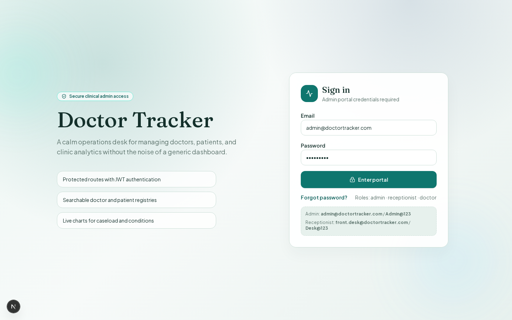

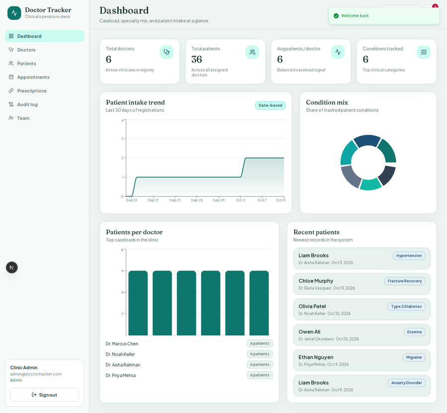

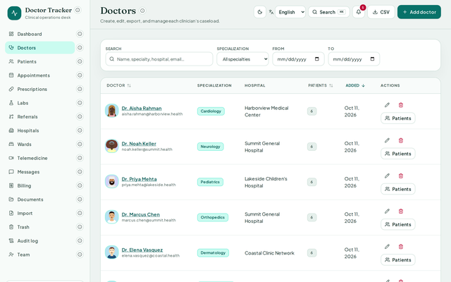

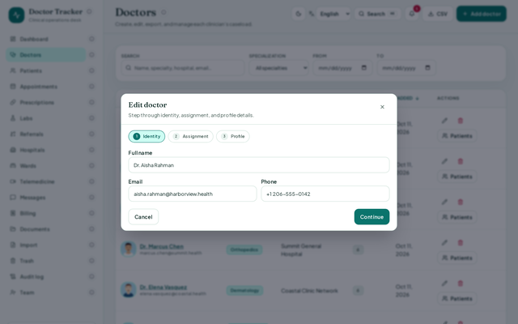

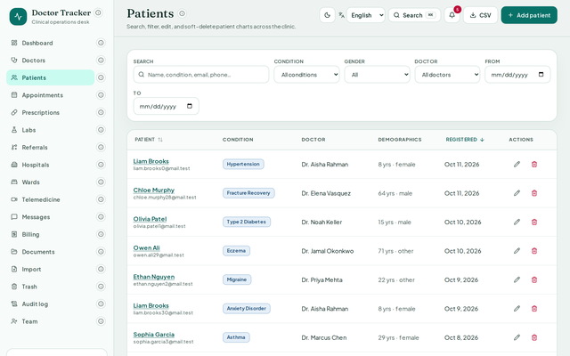

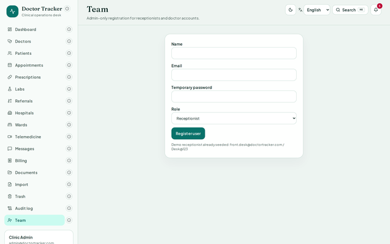

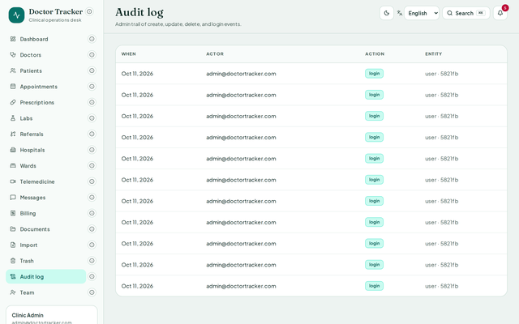

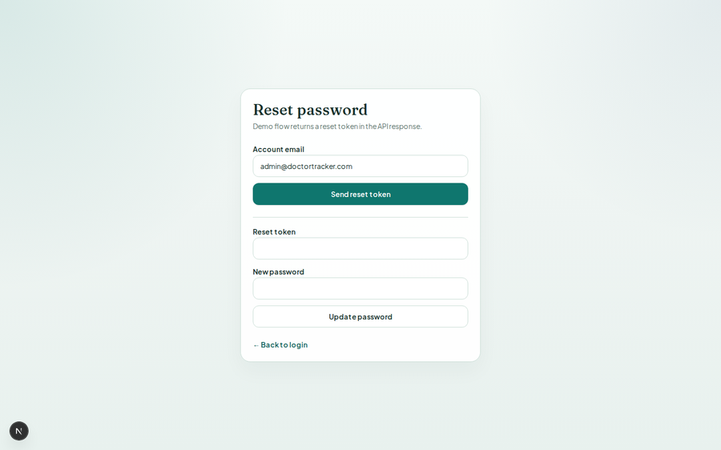

### Mobile

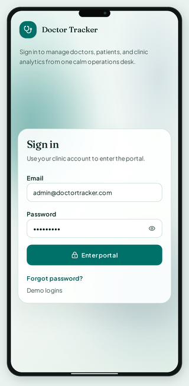

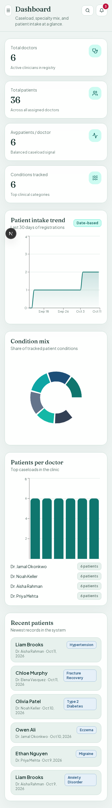

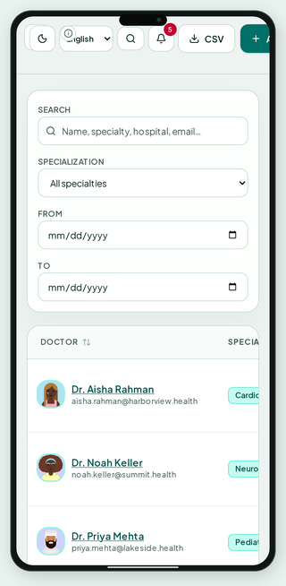

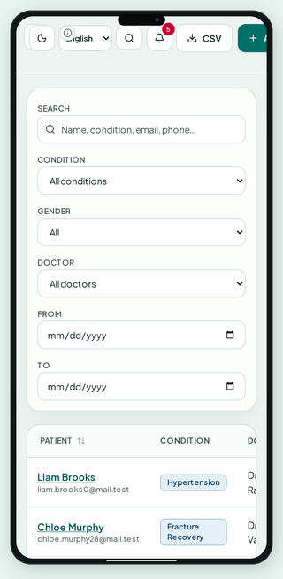

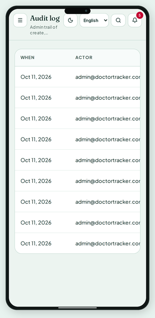

## API map (core)

| Method | Path | Purpose |
|--------|------|---------|
| POST | `/api/auth/login` | Login |
| POST | `/api/auth/register` | Admin registers user |
| POST | `/api/auth/forgot-password` | Issue reset token |
| POST | `/api/auth/reset-password` | Reset with token |
| GET | `/api/auth/me` | Current user |
| GET/POST | `/api/doctors` | List / create |
| PUT/DELETE | `/api/doctors/:id` | Update / soft-delete |
| GET | `/api/doctors/export.csv` | Export doctors |
| GET/POST | `/api/patients` | List / create |
| PUT/DELETE | `/api/patients/:id` | Update / soft-delete |
| GET | `/api/patients/export.csv` | Export patients |
| GET | `/api/audit` | Admin audit trail |
| GET | `/api/dashboard/stats` | Analytics (`from`/`to`/`hospital`/`specialization`) |
| GET/POST/DELETE | `/api/dashboard/presets` | Saved dashboard filter presets |
| GET/POST | `/api/appointments` | Schedule / list |
| PUT | `/api/appointments/:id` | Reschedule / status |
| GET/POST | `/api/labs` | Lab results |
| GET | `/api/labs/trends/:patientId` | Lab trend series |
| GET/POST | `/api/referrals` | Referral tracking |
| GET/POST | `/api/documents` | Document upload/list |
| GET | `/api/hospitals` | Hospitals + departments |
| POST | `/api/import/doctors` · `/patients` | Bulk CSV import |
| POST | `/api/doctors/:id/restore` · `/patients/:id/restore` | Soft-delete restore |
| GET | `/api/insights/hover/:feature` | Live hover tooltips |
